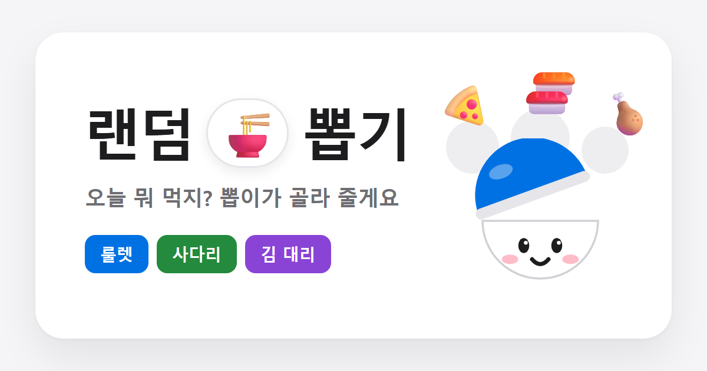

# 랜덤 [🍜] 뽑기

> 오늘 뭐 먹지? 고민은 뽑이가 대신 해 줄게요.

먹고 싶은 메뉴를 직접 적어 두면 **룰렛 · 사다리 · 김 대리** 세 가지 방식 중 하나로 메뉴를 골라 주는 웹페이지예요.
결과가 나오면 뽑기 캡슐 캐릭터 **뽑이**가 열리면서 음식이 튀어나오고, 메뉴에 맞춘 한마디를 건네요.

🔗 **바로 써 보기:** https://hanjusung318-hub.github.io/RamdomfoodMachine.github.io/



---

## 주요 기능

### 1. 후보 메뉴 직접 입력
- 메뉴 이름을 적고 **추가**(또는 Enter)를 누르면 후보에 들어가요. 하나에 최대 14자예요.
- 처음 열면 직장인 점심 단골 메뉴 6개가 기본으로 들어 있어요: 김치찌개 · 돈까스 · 쌀국수 · 제육볶음 · 초밥 · 마라탕
- **기본 메뉴로 되돌리기**를 누르면 언제든 기본 6개로 돌아가요.
- **메뉴 한 번에 지우기**를 누르면 후보를 모두 비우고 처음부터 직접 넣을 수 있어요.
- 넣은 메뉴는 브라우저에 저장돼서 다음에 열어도 그대로 있어요.
- 메뉴 이름을 보고 이모지를 자동으로 붙여요. 이름 **끝부분**을 기준으로 판단해서, 가게 이름이 붙어도 알아봐요.
  - 예: `놀부보쌈` → 🍖, `돈까스김밥` → 🍙, `치킨버거` → 🍔

### 2. 세 가지 뽑기 방식
가운데 영역을 **옆으로 스와이프**하거나 위쪽 탭을 눌러 바꿀 수 있어요. 세 방식이 후보 메뉴를 함께 써서, 메뉴를 바꾸면 안 보이는 방식에도 바로 반영돼요.

| 방식 | 색 | 메뉴 수 | 어떻게 고르나요 |
|---|---|---|---|
| 🎰 **룰렛** | 파랑 | 2~12개 | 파칭코식 3칸 릴이에요. 양쪽 칸이 결승 진출 메뉴 2개를 뽑고, **리치!** 상태에서 가운데 칸이 둘 중 하나를 정해요. 가끔 막판에 **역전!**이 나와요. |
| 🪜 **사다리** | 초록 | 2~12개 | 출발 번호를 고르거나 **랜덤 출발**을 누르면 선이 내려가요. 출발 전에는 가로 작대기를 가려 둬서 결과를 미리 알 수 없어요. |
| 🧑‍💼 **김 대리** `NEW` | 보라 | 2~3개 | 천장에 달린 모니터(2~3대)를 김 대리가 번갈아 보며 고민해요. 고르면 그 메뉴 줄 맨 뒤에 가서 서고, 모니터가 커지면서 결과로 넘어가요. |

**김 대리 화면의 디테일**
- 보고 있는 모니터만 켜지고, 머리에서 그 모니터까지 **시선 빛줄기**가 뻗어요.
- 생각 풍선 멘트는 화면에 뜬 **실제 후보 메뉴**를 보고 끌림과 반박을 오가요.
  - 예: "국물 땡기네… 김치찌개" → "아니야, 돈까스 헤비해" → **"결국 국물이지, 김치찌개!"**
- 마지막 멘트는 고른 메뉴의 성격에 맞춰 나와요. 성격은 국물, 매운 거, 면, 고기, 헤비, 가벼운 거, 밥, 디저트로 구분해요.
- 후보가 4개 이상이면 앞의 3개만 고민해요. "김 대리는 4개 이상 고민을 어려워해요."

### 3. 결과 화면
뽑이 등장 → 덜덜 → 뚜껑 딸깍 → 연기 펑 → 음식 이모지가 커지며 등장 → 메뉴 맞춤 멘트 말풍선, 순서로 나와요.
- 메뉴별 전용 멘트가 약 90개 있어요. 예: 보쌈 → "보들보들 수육에 보쌈김치 척 올려 먹으면 그게 최고지!"
- 전용 멘트가 없는 메뉴는 요리 종류별 멘트가 나와요.
- 결과 카드에 뽑은 **날짜와 시간**이 남아요. 예: `2026.11.25 (수) 12:03`
- 아래 **오늘 뽑은 메뉴**에 최근 결과가 쌓여요.

### 4. 확률 규칙
- 같은 메뉴는 **연속 2번까지만** 나와요. 3번째에는 나오지 않아요.
- 이 규칙은 세 방식 모두에 같이 적용돼요. 연출은 그대로 두고 티 나지 않게 처리해요.

---

## 사용법

1. **후보 메뉴**에 먹고 싶은 메뉴를 2개 이상 넣어요. 기본 메뉴를 그대로 써도 돼요.
2. 가운데 영역을 옆으로 넘겨 **룰렛 / 사다리 / 김 대리** 중 하나를 골라요.
3. 각 방식의 버튼을 누르거나 **스페이스바**를 눌러요.
4. 결과 화면에서 **이걸로 결정**을 누르거나, **다시 돌리기 / 다시 타기 / 다시 고르기**로 한 번 더 뽑아요.

---

## 파일 구성

| 파일 | 설명 |
|---|---|
| `menu-ticket-machine.html` | 페이지 전체가 이 파일 하나에 들어 있어요 (HTML · CSS · JS). 외부 라이브러리 없이 동작해요. |
| `og-image.png` | 링크 공유 미리보기 썸네일 (1200×630) |
| `og-thumbnail.html` | 썸네일 원본. 수정한 뒤 아래 명령으로 다시 PNG를 만들 수 있어요. |

---

## GitHub Pages에 배포하기

1. **`github-pages` 폴더 안의 파일 3개**(`index.html`, `og-image.png`, `README.md`)를 저장소 맨 위 폴더에 올려요.
   - `github-pages/index.html`은 `menu-ticket-machine.html` 앞에 문서 머리말(`<!doctype html>`, 글자 인코딩, 휴대폰 화면 맞춤, 탭 아이콘)을 붙인 배포용 파일이에요.
   - `menu-ticket-machine.html`을 그대로 올리면 휴대폰에서 화면이 작게 보일 수 있으니, 꼭 배포용 파일을 올려 주세요.
2. 저장소 **Settings → Pages**에서 배포 브랜치를 `main` / `root`로 설정해요.

> **공유 미리보기(카카오톡 등)가 예전 그대로라면**
> 카카오는 미리보기를 한동안 기억해요. [카카오 공유 디버거](https://developers.kakao.com/tool/debugger/sharing)에 페이지 주소를 넣고 **캐시 초기화**를 눌러 주세요.
>
> 주소를 바꿨다면 `index.html` 맨 위의 `og:url`, `og:image`, `twitter:image` 값도 새 주소로 바꿔야 해요.

### 썸네일 다시 만들기 (Windows, Edge)
`og-thumbnail.html`을 고친 뒤 PowerShell에서 실행해요. 이 프로젝트 폴더 안에서 실행해야 해요.
```powershell
& "${env:ProgramFiles(x86)}\Microsoft\Edge\Application\msedge.exe" --headless=new --hide-scrollbars --window-size=1200,630 --screenshot="$PWD\og-image.png" "file:///$($PWD -replace '\\','/')/og-thumbnail.html"
```

---

## 직접 바꿔 보기

모두 `menu-ticket-machine.html` 안의 `<script>`에 있어요. 아래 이름으로 검색하면 바로 찾을 수 있어요.

| 바꾸고 싶은 것 | 찾을 이름 |
|---|---|
| 기본 후보 메뉴 | `DEFAULT_MENUS` |
| 메뉴 → 이모지 연결 규칙 | `EMOJI_DICT` |
| 결과 화면의 메뉴별 멘트 | `LINE_SPECIFIC` (메뉴별), `LINE_BY_EMOJI` (요리 종류별) |
| 김 대리 속마음 멘트 | `QUICK`, `PRO`, `CON`, `FINAL` |
| 화면 안내 · 오류 문구 | `COPY` |
| 방식별 색 | CSS의 `--mode-slot`, `--mode-ladder`, `--mode-office` |
| 탭 · 상태 표시 크기 | CSS의 `--ctl-w`, `--ctl-h` |

문구는 이 기준으로 맞춰 두었어요.
- 화면 안내, 버튼, 오류는 **해요체**로 짧게 써요.
- 캐릭터(뽑이, 김 대리)만 **반말**을 써요.

---

## 기술 메모

- **파일 하나로 끝:** HTML · CSS · JS가 한 파일에 있어요. 빌드도, 서버도 필요 없어요.
- **애니메이션:** 룰렛 릴은 `requestAnimationFrame`, 사다리는 SVG 경로, 김 대리는 SVG와 CSS 전환으로 움직여요.
- **결과 이모지:** 큰 글자로 띄우면 버벅여서, 캔버스에 한 번 그린 이미지를 GPU 레이어에서 움직여요. 결과 창이 떠 있는 동안에는 뒤쪽 애니메이션을 멈춰요.
- **이모지 글꼴:** 한글 글꼴이 이모지를 눌린 모양으로 그리지 않도록, 모든 이모지를 컬러 이모지 글꼴로 그려요.
- **다크 모드:** 시스템 설정에 맞춰 자동으로 바뀌어요.
- **모션 줄이기:** OS의 "동작 줄이기" 설정을 켜면 애니메이션을 짧게 줄여요.
- **저장:** 후보 메뉴는 `localStorage`의 `random-food-list-v2` 키에 저장돼요. 연속 기록과 오늘 뽑은 메뉴는 새로고침하면 초기화돼요.
